# Testy
Dokument opisuje testy wykonane w lokalnym środowisku Minikube oraz polecenia do ich powtórzenia. Sekcje „Wykonany test” opisują testy, które faktycznie przeprowadzono i udokumentowano zrzutami ekranu. Sekcje „Testy ręczne” zawierają polecenia do samodzielnego sprawdzenia, bez udokumentowanego wyniku.

Polecenia zakładają domyślną konfigurację projektu i aktywny kontekst `pg-lab`. Testy wykonywano w różnym czasie na różnych wersjach PostgreSQL (18.7 i 18.6), dlatego zrzuty pokazują różne wersje.

## Stan klastra
### Wykonany test: rozmieszczenie instancji PostgreSQL
Sprawdzono, czy wszystkie instancje klastra działają i na których węzłach zostały uruchomione.
```bash
kubectl -n database get pods -o wide -L cnpg.io/instanceRole
```
Wszystkie trzy instancje mają status `Running` i działają na różnych węzłach:
- `pg-cluster-1` – węzeł `pg-lab-m03`, Primary,
- `pg-cluster-2` – węzeł `pg-lab-m02`, Replica,
- `pg-cluster-3` – węzeł `pg-lab`, Replica.

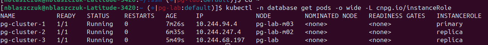

### Testy ręczne
```bash
kubectl get nodes
kubectl -n database get clusters,pods,pvc,svc
```

## Dostęp z wnętrza klastra
### Wykonany test: połączenie i szyfrowanie
Z poda `database-connection-check-allowed` (namespace `sandbox`, etykieta `db-access: "allowed"`) sprawdzono połączenie z bazą.
```bash
kubectl -n sandbox exec deploy/database-connection-check-allowed -- /app/db-check.sh --check
```
Aplikacja połączyła się jako `test_user` z bazą `test_db` przez szyfrowane połączenie (`ssl = t`, TLSv1.3, `TLS_AES_256_GCM_SHA384`). Wersja serwera: PostgreSQL 18.7.

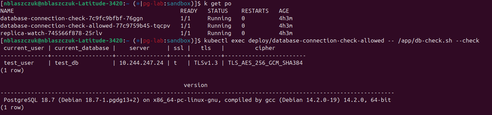

### Wykonany test: operacje na danych
Sprawdzono odczyt, usuwanie i dodawanie rekordów w tabeli `users`.
```bash
kubectl -n sandbox exec deploy/database-connection-check-allowed -- /app/db-check.sh --list
kubectl -n sandbox exec deploy/database-connection-check-allowed -- /app/db-check.sh --delete 7
kubectl -n sandbox exec deploy/database-connection-check-allowed -- /app/db-check.sh --add natalia natalia@test
kubectl -n sandbox exec deploy/database-connection-check-allowed -- /app/db-check.sh --list
```
Wszystkie operacje zakończyły się poprawnie. Ponowny odczyt nie zawiera już rekordu o `id = 7`, zawiera za to nowy rekord o `id = 140`.

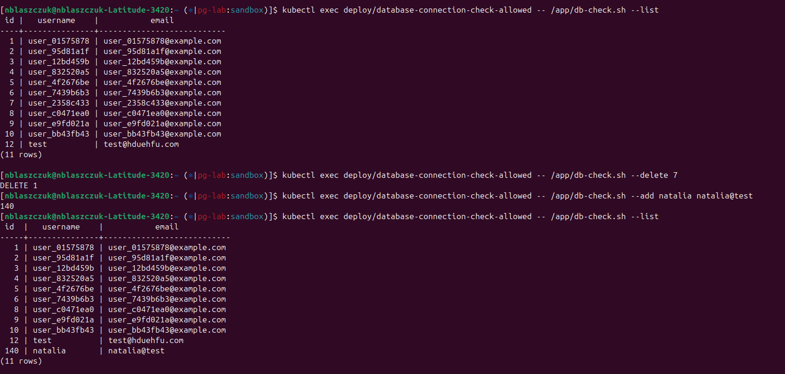

## NetworkPolicy
### Wykonany test: pod bez etykiety
Z poda `database-connection-check`, który nie ma etykiety `db-access`, próbowano połączyć się z serwisem `pg-cluster-rw`.
```bash
kubectl -n sandbox exec deploy/database-connection-check -- env PGCONNECT_TIMEOUT=5 /app/db-check.sh --check
```
Połączenie zakończyło się błędem `timeout expired`, a nie np. błędem uwierzytelniania. Pakiety zostały odrzucone przez NetworkPolicy, zanim dotarły do PostgreSQL. Ten sam skrypt w podzie z etykietą łączy się poprawnie (sekcja wyżej).


## Dostęp spoza klastra
### Wykonany test: połączenie z kontenera Docker
Sprawdzono, czy kontener `database-connection-check-external` działa na hoście, poza klastrem, i czy łączy się z bazą przez NodePort.
```bash
docker ps --filter name=database-connection-check-external
docker exec database-connection-check-external sh /app/db-check.sh --check
```
Kontener działa. Połączenie zostało nawiązane jako `test_user` z bazą `test_db`, z aktywnym SSL (TLSv1.3, `TLS_AES_256_GCM_SHA384`). Wersja serwera: PostgreSQL 18.6.

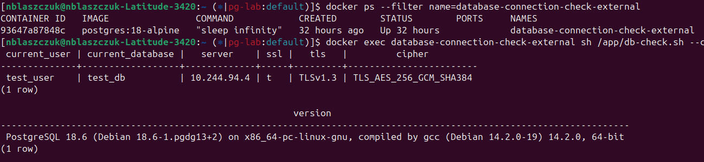

### Testy ręczne
Operacje na danych z kontenera zewnętrznego:
```bash
docker exec database-connection-check-external sh /app/db-check.sh --list
docker exec database-connection-check-external sh /app/db-check.sh --add jan jan@example.com
docker exec database-connection-check-external sh /app/db-check.sh --delete 5
```

Bezpośrednie połączenie z hosta:
```bash
psql "host=$(minikube ip -p pg-lab) port=30432 user=test_user dbname=test_db sslmode=require" -W
```

## Bezpieczeństwo
### Wykonany test: wymuszenie TLS
Z poda z etykietą dostępu próbowano połączyć się bez szyfrowania.
```bash
kubectl -n sandbox exec deploy/database-connection-check-allowed -- \
  env PGSSLMODE=disable PGCONNECT_TIMEOUT=5 \
  /app/db-check.sh --check
```
PostgreSQL odrzucił połączenie komunikatem `FATAL: pg_hba.conf rejects connection ... no encryption`. Nieszyfrowane połączenie klienckie nie jest przyjmowane przez serwer.

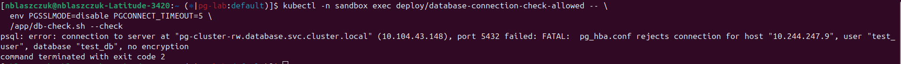

### Wykonany test: nieprawidłowe hasło
```bash
kubectl -n sandbox exec deploy/database-connection-check-allowed -- \
  env PGPASSWORD=incorrect_password \
  /app/db-check.sh --check
```
Otrzymano oczekiwany błąd `FATAL: password authentication failed for user "test_user"`. Połączenie z nieprawidłowym hasłem zostało odrzucone.

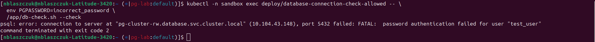

### Wykonany test: dostęp do repliki
Przez serwis `pg-cluster-ro` (repliki) wykonano połączenie, odczyt i próbę zapisu.
```bash
kubectl -n sandbox exec deploy/database-connection-check-allowed -- \
  env PGHOST=pg-cluster-ro.database.svc.cluster.local \
  /app/db-check.sh --check

kubectl -n sandbox exec deploy/database-connection-check-allowed -- \
  env PGHOST=pg-cluster-ro.database.svc.cluster.local \
  /app/db-check.sh --list

kubectl -n sandbox exec deploy/database-connection-check-allowed -- \
  env PGHOST=pg-cluster-ro.database.svc.cluster.local \
  /app/db-check.sh --add readonly_test readonly@example.com
```
Połączenie zostało nawiązane przez TLSv1.3, a odczyt zwrócił 10 rekordów. Próba dodania rekordu zakończyła się błędem `ERROR: cannot execute INSERT in a read-only transaction`. Z repliki można czytać dane, ale nie można na niej zapisywać.

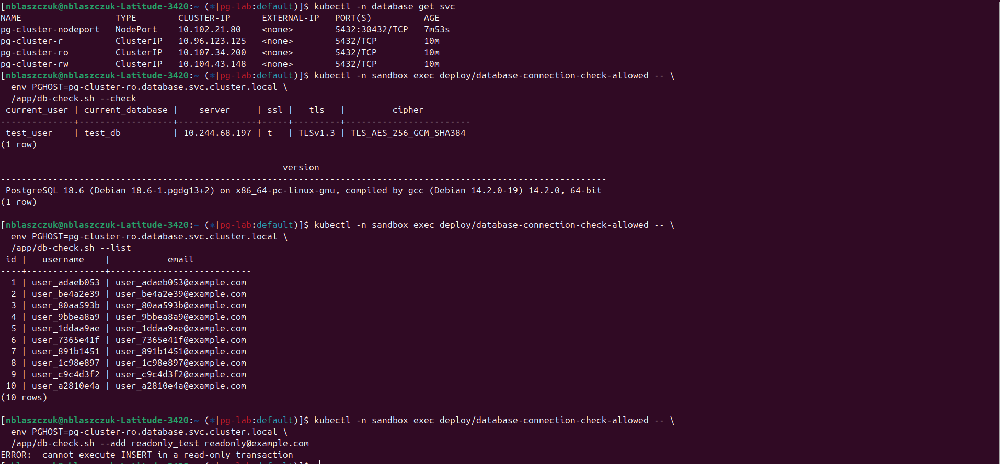

## Failover
### Wykonany test: zmiany instancji Primary
W podzie `replica-watch` uruchomiono skrypt, który co sekundę otwiera nowe połączenie z serwisem `pg-cluster-rw` i wypisuje nazwę poda, który odpowiedział (aktualny Primary). Testy obejmowały kolejne zmiany instancji Primary. Po każdej zmianie aplikacja ponownie nawiązywała połączenie przez ten sam serwis `pg-cluster-rw`, bez zmian w swojej konfiguracji.

Podane czasy to orientacyjne odstępy między ostatnim poprawnym połączeniem ze starym Primary a pierwszym poprawnym połączeniem z nowym Primary. Nie są to dokładne pomiary niedostępności bazy.
```bash
kubectl -n sandbox exec -it deploy/replica-watch -- /app/replica-watch.sh
```

Skrypt odczytuje nazwę poda z ustawienia `primary_slot_name`, które CNPG ustawia na instancjach działających wcześniej jako repliki. Na świeżym klastrze pierwszy Primary jest więc pokazywany jako adres IP, a po pierwszym failoverze jako nazwa poda. Zrzuty poniżej pochodzą z klastra, który miał już za sobą wcześniejsze przełączenia, dlatego widać na nich tylko nazwy podów.

Przebieg 1: w drugim terminalu dwa razy z rzędu usunięto pod pełniący rolę Primary. Primary zmienił się z `pg-cluster-1` na `pg-cluster-2` (ok. 4 s), a następnie z `pg-cluster-2` na `pg-cluster-3` (ok. 10 s).

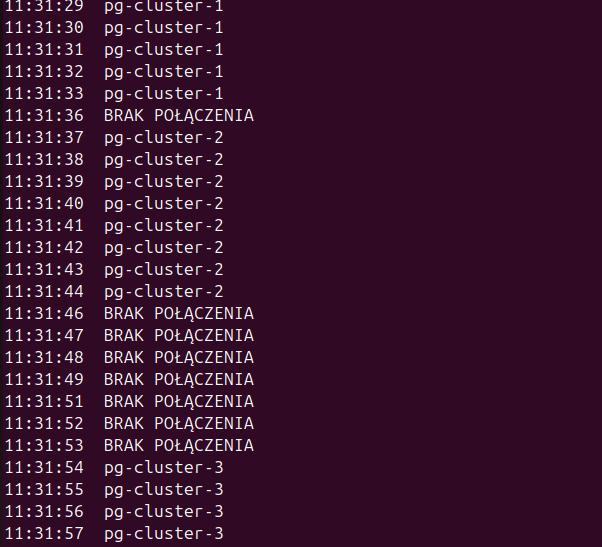

Przebieg 2: w drugim terminalu usunięto kolejno pody `pg-cluster-1` i `pg-cluster-2`, za każdym razem pełniące rolę Primary.
```bash
kubectl -n database delete pod pg-cluster-1
kubectl -n database delete pod pg-cluster-2
```

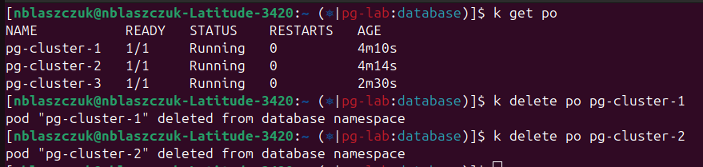

Po usunięciu `pg-cluster-1` rolę Primary przejął `pg-cluster-2` (ok. 3 s). Po usunięciu `pg-cluster-2` rolę Primary przejął ponownie `pg-cluster-1`, utworzony na nowo przez operatora (ok. 6 s).

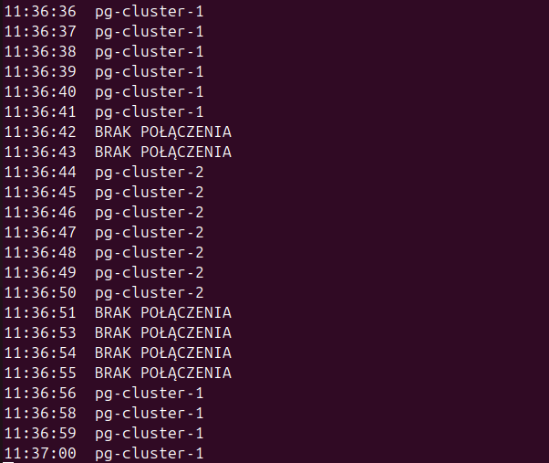

### Testy ręczne
Usunięcie poda, który jest aktualnie Primary, bez podawania jego nazwy. Test należy wykonywać wyłącznie w środowisku demonstracyjnym.
```bash
kubectl -n database delete pod -l cnpg.io/cluster=pg-cluster,cnpg.io/instanceRole=primary
```

## Backup
### Wykonany test: ręczne uruchomienie Joba
Na podstawie istniejącego CronJoba ręcznie uruchomiono Job backupu. Nie testowano harmonogramu CronJoba ani usuwania kopii starszych niż 7 dni.
```bash
JOB=pg-backup-manual-$(date +%s)
kubectl -n backup create job --from=cronjob/pg-backup "$JOB"
kubectl -n backup wait --for=condition=complete job/"$JOB" --timeout=300s
kubectl -n backup logs job/"$JOB"
```
Job zakończył się poprawnie i utworzył plik `/backup/test_db_20261125_004155.dump` (rozmiar w logach: 4.0K). Po zakończeniu zadania przechowywane były trzy pliki backupu.

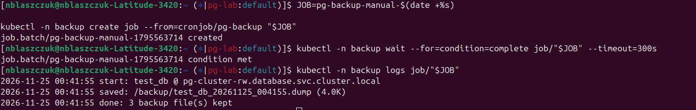

### Wykonany test: odtworzenie backupu
Wynik automatycznego testu odtworzenia, który wykonuje rola Ansible `pg-backup` podczas wdrożenia. Test użył pliku `/backup/test_db_20261125_004408.dump`, czyli innego niż plik z ręcznego testu powyżej.
```text
Rows in test_db.users: 10
Rows in test_db_restore.users: 10
Row counts match
```
Test zakończył się poprawnie, liczba rekordów w tabeli źródłowej i odtworzonej jest taka sama. Porównywana jest tylko liczba rekordów, nie pełna zawartość danych.

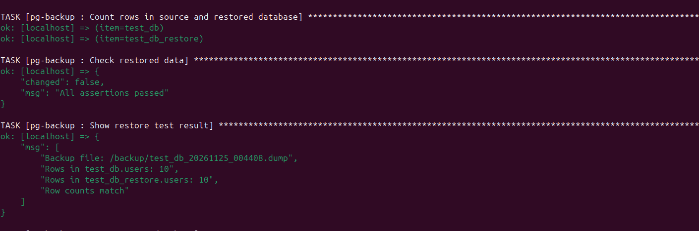

### Testy ręczne
Przed ręcznym uruchomieniem backupu należy upewnić się, że inne zadanie backupowe nie jest aktualnie wykonywane:
```bash
kubectl -n backup get jobs
```

Automatyczny backup podczas wdrożenia oraz test odtworzenia można wyłączyć zmiennymi:
```yaml
pg_backup_run_on_deploy: false
pg_backup_restore_test: false
```
